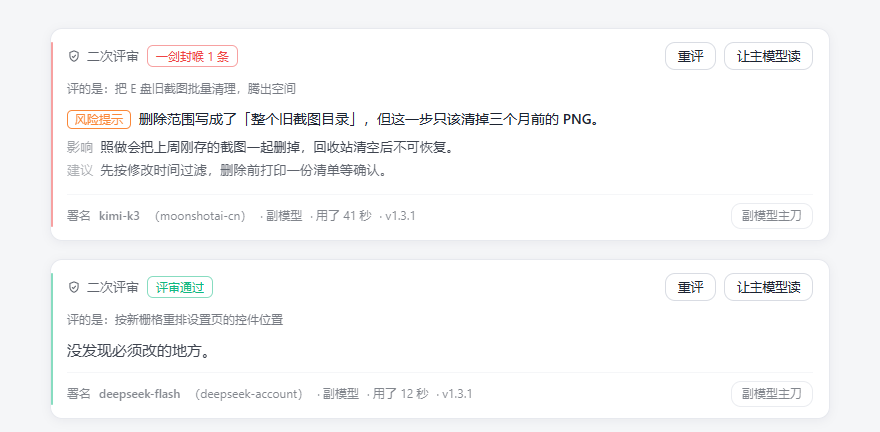

# dsh-second-review

> Independent second-opinion review for DeepSeek Harness.
> 主模型负责执行，副模型负责复核；结论以卡片形式附在原回复下方。


---

## 00 · 三十秒看懂

你问 AI 一个问题，它答了。这个插件让**另一个不同来源的 AI** 再看一遍这一轮，只回答一件事：**这一轮有没有会让你吃亏的地方。**

- 结论只有四种：**通过** ／ **一剑封喉**（不改不行）／ **一针见血**（可以留意）／ **没评成**。
- 它只挑会造成损失的毛病——删错、丢数据、白花钱、返工、被误导、方案根本不成立。措辞、标点、礼貌这类它不写。
- 结果是一张卡片，附在原回复下方；不改动、不接管你正在进行的对话。



> 上图为评审卡片的实际布局：左竖线表示结论档位，条目带「影响」与「建议」，底栏标注评审模型、角色、耗时与版本。

它解决的不是"AI 不够聪明"，而是"AI 自己看不见自己"——见下一节。

---

## 01 · 定位

SEC 是一个**主执行者 + 独立监督者**的组合：主模型完成回答后，由一个**不同来源**的模型对同一轮做独立复核，判断"这一轮该不该拦下"。

它是复核，不是重答。不接管发送权，不修改消息归属，不替用户对外发送。

| 做 | 不做 |
|-|-|
| 对指定一轮做独立复核 | 改写主模型的原始回答 |
| 指出会被忽略的代价与失败路径 | 向会话插入隐藏消息 |
| 给出可执行的修正方向 | 默认修改工作区文件 |
| 结论落盘，可回溯 | 自动替用户做决定 |
| 机器核对"引用的用户原话"是否有出处 | 跨轮补充评审（只评点到的那一轮及以前） |

### 为什么需要"另一个脑子"

让一个模型检查自己的回答，有绕不过去的结构性缺陷：它是在用自己的眼睛检查自己的眼睛。它看不见的东西，"再反思一遍"并不会变得可见——盲区是固定的，不是不努力。

所以 SEC 不要求同一个模型"想得更认真一点"，而是换一个**不同训练来源**的模型来看同一轮。两个异构模型在同一点上同时犯错的概率，远低于任何一个单独犯错。这就是"独立复核"与"再检查一遍"的区别：前者补盲区，后者只是多花一次钱。

两个前提，坦率说清：

- **副模型要和主模型足够不同。** 同源同系列的两个模型，眼睛长得太像，盲区高度重叠，复核收益接近于零。
- **它降低漏检率，不等于零漏检。** 若两个模型恰好在同一类问题上怀有一致偏见，交叉复核照样看不见。它是额外一道检查，不是保险。

这也是「副模型主刀」的由来：换一个脑子不只为挑毛病，必要时它可以直接接活——让擅长这件事的一方先作答，另一方复核。角色可翻转，比单向批改更接近对质。

---

## 02 · 功能

| 功能 | 作用 | 费用 |
|-|-|-|
| **二次评审** | 复核当前轮（含此前对话） | 一次副模型调用 |
| **自动评审** | 新回复到达后自动复核一次（**默认关闭**） | 同上，按条计 |
| **副模型主刀** | 交换角色：下一轮由副模型回答，原主模型复核 | 按对应模型计 |
| **让主模型读** | 将评审结论交给主模型，促其正面回应 | 一次主模型调用 |
| **停止** | 中止进行中的复核；已生成内容保留可查 | 已产生费用不退回 |
| **先看效果** | 用模拟数据渲染卡片 | 无 |
| **引文核验** | 核对回复中"用户原话"是否有会话记录支撑 | 无（本地比对） |
| **署名与用时** | 卡片与落盘文档标注评审模型、角色、耗时 | 无 |

---

## 03 · 评审方法

**锚定话题。** 先写清"这一轮在解决什么"；说不清时输出 `unclear`——既不算通过，也不算没问题。

**只报有代价的问题。** 仅接受以下六类：删错、丢数据、白花钱、返工、被误导、方案从根上不成立。

**每条必须给出影响。** 写不出具体代价的条目会被代码层丢弃——这不是提示词约定，是服务端的硬过滤。

**分档与上限。** 结论四档：`pass` / `major`（一剑封喉，≤2 条）/ `minor`（一针见血，≤1 条）/ `unclear`。超出上限时会明示"另有 N 条被省略"，不静默丢弃。

**噪声过滤。** 措辞、标点、排版、礼貌，以及"越权／擅自／应该先问／流程不规范"这类流程性意见，一律不写。

**引文核验（v1.1.0 起）。** 复核对象里凡引作「你说的」的原话，都会与当前会话的用户消息做本地比对；查不到出处的在卡片上标出。只检查**被复核的那条回复**，且归属词必须紧邻引号（`你说`／`你刚才说`／`你的原话是`）。定位是安全带，不是判决书：查不到 ≠ 一定是编造，它不参与结论。

---

## 04 · 副模型配置

评审的收益高度依赖主副模型的**差异度**。同源、同档次的配对，收益接近于零。

### 模式一：快筛 + 精审（日常迭代、草稿阶段）

| 项 | 建议 |
|-|-|
| 主模型 | 轻量快速型（如 DeepSeek V4.1 Flash、GPT-4o-mini、Claude Haiku） |
| 副模型 | 显著更强的大参数模型（如 Qwen3.8-Max、DeepSeek V4 Pro、Claude Opus 5.5） |
| 场景 | 代码初稿、方案草案、事实性内容生成 |
| 注意 | 主模型至少要保证基本逻辑无误；否则复核会退化为低效纠错，Token 消耗反而更高 |

### 模式二：能力互补（关键交付、对外发布）

| 项 | 建议 |
|-|-|
| 主模型 | 工程/逻辑强项（如 DeepSeek V4.1 Flash、Qwen3.8-Coder） |
| 副模型 | 文字/表达强项（如 GPT-4o、Qwen3.8-Max-Literary） |
| 场景 | 手稿精修、技术文档包装、对外交付物终审 |
| 注意 | 文学型副模型可能越界改写；评审指令已限制其「只标注、不动笔」，如仍发现擅自重写，检查「允许改文件」是否被开启（默认关闭） |

### 不建议的配对

- **主副同源同系列**：盲区高度重叠，复核价值低。
- **副模型不比主模型显著更强**：模式一里等于白花钱。
- **副模型上下文过小（< 32k）**：长对话会被服务端拒绝，表现为「没调通」。

### 何时开启、何时不必

- 建议：文学精修、代码 review、方案决策、对外交付前终审。
- 不必：简单事实问答、闲聊、主模型输出已粗糙到需要重写的场景。
- 省 Token：日常走模式一，关键节点切模式二；不确定时先点「先看效果（不花钱）」。

### 换模型的信号

| 现象 | 处理 |
|-|-|
| 单次复核耗时过长 | 换更快的档位 |
| 长期只判通过，而你对结果存疑 | 换更强的模型；并把这一轮的目标写进对话——它只看得到对话与文件，看不到你的判断标准 |
| 反复挑标点、路径、措辞 | 多为模型话多，换一个即可，不必修改需求 |
| 长对话中持续变慢 | 部分模型会逐句过一遍，属模型行为，不是插件故障 |

> 模型名称为写作时的示例。实际可选范围以你 DSH 中已配置的 provider 为准；未指定时默认 `deepseek-flash`。

---

## 05 · 协作工作流

**单轮闭环**

```
主模型回答 → 二次评审（副模型） → 让主模型读 → 主模型修正
```

**反向主刀**：开启「副模型主刀」后，下一轮由副模型回答，复核改由原主模型执行。适合比较两个模型对同一任务的处理差异。该状态按会话保存，切换会话需分别设置。

**长任务**：在关键节点手动复核，而不是每一轮都开自动评审——自动评审的成本与条数线性相关。

---

## 06 · 安装

> 当前仅在 **Windows 桌面端** 验证通过；macOS / Linux 未做测试。

**方式一：按包名安装（推荐）**

1. DSH → **插件** → **添加插件**；
2. 在包名一栏填 `dsh-second-review`，确认安装（从 npm 取最新版）；
3. 插件列表出现 `dsh-second-review`，点击启用；
4. 完全退出并重新打开 DSH。

**方式二：本地目录**

1. 将 `dsh-second-review` 文件夹放到任意位置（路径可含空格与中文，勿改名）；
2. DSH → **插件** → **添加插件**；
3. 粘贴绝对路径：

```
file:C:\Users\<用户名>\Documents\dsh-second-review
```

4. 安装后插件列表出现 `dsh-second-review`，点击启用；
5. 完全退出并重新打开 DSH。

**方式三：压缩包**

将 `dsh-second-review-1.3.4.tgz` 发给对方，在「添加插件」中选择该压缩包。

**设置页**位于 **插件 → 二次评审**，分四段：01 模型 / 02 评审模式 / 03 权限 / 04 关于。修改后需点击底部「保存」，未保存时页面会提示。

**首次使用**：建议自动评审保持关闭，先点「先看效果（不花钱）」，再做第一次真实复核（首次会展示费用与数据去向说明）。配副模型时先看默认值：默认 `deepseek-flash`，你的主模型如果也是它，这次复核等于自评——换一个不同来源、或至少不同档位的模型才有用。

**更新**：以新版本覆盖同一目录，再重新添加一次相同路径，然后重启 DSH。配置与评审记录保存在插件目录之外，不会因覆盖丢失。

---

## 07 · 配置项

配置文件：`%USERPROFILE%\.dsh\dsh-second-review\config.json`

| 字段 | 默认 | 说明 |
|-|-|-|
| `provider` / `model` | `deepseek-account` / `deepseek-flash` | 副模型 |
| `auto` | `false` | 新回复自动复核 |
| `mock` | `false` | 测试模式：模拟数据，不调模型、不落盘 |
| `allowWrite` | `false` | 是否向副模型提供写文件工具 |
| `budgetSec` | `0` | 总时长上限（秒），`0` 为不限 |
| `idleSec` | `0` | 空闲判停（秒），`0` 为不判 |
| `checkQuotes` | `true` | 引文核验 |
| `noticeAck` | `false` | 首次费用告知是否已确认 |

> 升级提示：默认值不会覆盖已保存的旧值。换版本后请查看 02 段中「最长等待」「没动静就收手」的实际显示值。

---

## 08 · 费用

插件不提供模型额度，使用 DSH 中已配置的模型服务与账号。

- 一次真实复核 = 一次副模型调用；若需读取文件、多轮工具调用或补救重试，会产生多次请求；
- 自动评审按条计费；
- 测试模式与「先看效果」不产生费用；
- 「副模型主刀」按副模型计费；
- 「让主模型读」额外产生一次主模型调用。

---

## 09 · 权限与隐私

**对话数据**：发起真实复核后，当前轮及以前的用户／助手文本发送至你所配置的副模型服务商。最多读取最近 60,000 字符，更早内容被截断并在卡片上标注。

**工作区文件**：副模型通过只读工具（读取、列目录、查找、搜索）查阅工作区。以下内容不可读：

- `AGENTS.md`、`AGENTS.md.off`；
- `记忆卡\` 整个目录；
- `.dsh\` 目录（若位于工作区内）；
- 工作区以外的任何路径；
- 指向上述位置或工作区外部的符号链接与目录联接（按真实路径判定）。

**写入权限**：默认关闭。关闭时不向副模型提供 `write_file`；即使手动开启，执行层仍会二次校验权限与目标路径。

**本地数据**：

```
配置：%USERPROFILE%\.dsh\dsh-second-review\config.json
评审：<当前工作区>\二次评审\（最新.md + 历史文件）
```

卸载插件不会删除上述配置与评审记录。

---

## 10 · 已知限制

1. **复核不是正确性保证。** 副模型同样会犯错，也可能与主模型共享盲区；它是额外检查，不是保险。
2. **同源配对收益低。** 主副为同一模型或同一系列时，独立视角有限。
3. **只评点到的那一轮及以前**，不纳入其后的新回复。
4. **60,000 字符为字符数，不是 token。** 中文约 1 字对应 1–2 token，实际可容纳量取决于副模型的上下文窗口；窗口过小时服务端会直接拒绝，表现为「没调通」。
5. **工具交互上限 8 轮**，复杂任务可能一次查不完。
6. **默认不设总时长上限**，可随时停止；可选的空闲闸默认关闭，其语义是"连续 N 秒无任何输出才收手"，不是限时。
7. **卡片内容在解析完成后分段呈现**，并非逐字流式——复核结果以 JSON 返回，逐字显示只能暴露原始结构。
8. **评审卡不进入会话记录**：导出对话或在其他客户端查看时不可见，但 `二次评审\` 中的 Markdown 始终保留。
9. **「副模型主刀」为会话级状态**，切换会话需分别设置；手动在模型选择器中改过模型后，插件保存的原模型可能与现状不一致。
10. **引文核验为窄口径**：仅识别紧邻归属词的引用，隔句转述不在检查范围内。

### 常见故障排查

| 现象 | 先查什么 |
|-|-|
| 插件列表里找不到 / 装了不显示 | 包名与目录名是否为 `dsh-second-review`；装完是否**整窗重启**过 DSH |
| 点评审没反应 | 设置页 01 段是否选好模型；02 段「最长等待」是否被设成很短 |
| 提示「没调通」 | 副模型是否可用、账号是否有额度；上下文窗口过小的模型在长对话里会被服务端拒绝 |
| 立刻结束、什么都没说 | 是否开了空闲闸且值过小；是否点了「停止」 |
| 卡片内容与预期差很多 | 这一轮的目标是否写进了对话；副模型只看得到对话与文件 |
| 副模型主刀开了没生效 | 主刀是**会话级**状态；换会话要重开一次；是否在设置页改了模型导致原模型记录不一致 |
| 外观不对（卡片发白/发灰） | 是否装了壁纸类插件；插件读取宿主变量失败时会退回中性灰，属预期降级 |

---

## 11 · 接口（技术参考）

会花钱、会改状态的接口仅接受 `POST` + `application/json`。

| 方法 | 路径 | body |
|-|-|-|
| GET | `/ping`、`/models`、`/config`、`/progress` | — |
| POST | `/review` | `{sessionId, seq, job, mock}` |
| POST | `/config` | `provider` / `model` / `auto` / `mock` / `allowWrite` / `budgetSec` / `idleSec` / `checkQuotes` / `noticeAck` |
| POST | `/swap` | `{sessionId, on}` |
| POST | `/cancel` | `{job}` |
| POST | `/ask` | `{text}`（连通性调试） |

路径前缀为 `/plugins/dsh-second-review`。`seq` 为该轮最后一个节点的序号，服务端只读取 `seq <= seq` 的记录。

---

## 12 · 版本

当前 **1.3.4**。

| 版本 | 主要内容 |
|-|-|
| 0.4.0 | 写文件默认关闭、工作区按次隔离、评审绑定轮次、真实路径判黑名单、付费接口仅 POST |
| 0.5.0 | 评审标准重做：锚定话题、强制影响字段、噪声过滤、四档结论、条数上限 |
| 0.6.x | 可靠性：首次告知、流中超时、断流重试、按轮次缓存、每次落盘 |
| 0.7.x | 外观：卡片与设置页玻璃化、控件手感、思考流字幕与真实时间进度条 |
| 0.8.0 | 署名：卡片与落盘文档标注评审模型、provider、角色 |
| 0.9.x | 移除 45 秒总时长闸；可选空闲闸；「停止」与中断保留；更宽的结论解析与补救调用 |
| **1.0.0** | 更名为 `dsh-second-review`；安装与分发口径统一；图标与 MIT 许可证 |
| **1.0.1** | 外部工程审核修复：旧格式 severity 错位、截断提示位置与总长、provider 切换竞态、进度条读实时配置；落盘失败不再当作路径下发 |
| **1.1.0** | 引文核验：本地比对"用户原话"是否有会话记录支撑 |
| **1.1.1** | 设置页保存状态可见；卡片显示当前副模型 |
| **1.2.0** | 界面重排：三档按钮、卡片四段结构、设置页项值对齐 |
| **1.3.0** | 主按钮改为强调色玻璃；卡片入场、内容分段淡入、展开收起过渡；不注入全局样式、不引库 |
| **1.3.1** | 引文核验收窄：仅核被复核的回复，归属词须紧邻引号；修复术语误报 |
| **1.3.2** | 上架 npm；补仓库与 Issue 入口；README 增补 30 秒速览、设计动机、卡片示例图、故障排查、反馈渠道 |
| **1.3.3** | 仓库根目录化后同步：repository 去掉 directory，README 图片改回相对路径（由 npm 依仓库地址解析） |
| **1.3.4** | 安装文档补「按包名安装」；修正压缩包版本号与更新日志里的错字 |

---

## 13 · 许可证

MIT。可自由使用、修改、再分发，保留版权声明即可。

---

## 14 · 反馈与贡献

问题、建议、配对经验都欢迎：**https://github.com/RainSnowYY/dsh-second-review/issues**

| 想说的 | 请附上 |
|-|-|
| 报错、异常行为 | 插件版本（设置页 04 关于）、DSH 版本、复现步骤 |
| 评审质量、费用、配对心得 | 这一轮你**原本想解决什么** |
| 不方便公开的复现文件 | 在 Issue 里说明，再单独联系作者 |

说明「评审不准」时，若能讲清**这一轮你原本想解决什么**，定位会快很多——模型只看得到对话与文件，看不到你脑子里的判断标准；不少"没评到点上"，其实是它不知道该按什么标准评。

配对经验同样欢迎提交：04 节的推荐配置只是示例，真实有效的组合远不止那几组。

---

**SEC 不承诺让 AI 永远正确。**
它提供的是一道额外的独立检查：让容易被忽略的问题，在造成损失之前被看见。
